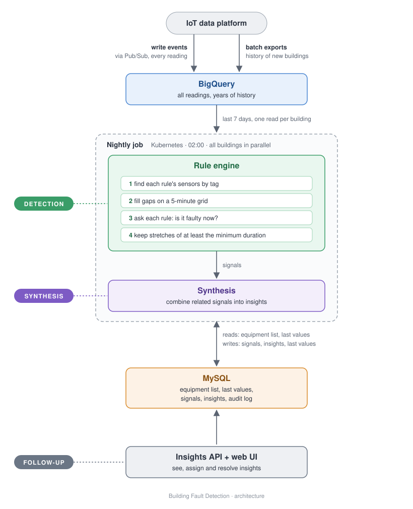

# Building Fault Detection

A design for finding performance problems in commercial buildings from sensor data, with its core built in Java
and its cloud infrastructure in Terraform.

Buildings produce a constant stream of readings: temperatures, valve positions, fan commands. Somewhere in that
stream are the signs of wasted energy and failing equipment, for example an air handling unit that heats and cools
the same air at the same time, for hours. This project turns those readings into a short list of problems a person
can act on.



## What's in here

| Folder / file | What it is |
|---|---|
| [`design-document.md`](design-document.md) | The full design: architecture, decisions and trade-offs, MVP scope. **Start here.** |
| [`rule-engine/`](rule-engine/) | The core of the rule engine, in Java: rules, and the engine that turns their answers into fault signals. |
| [`infrastructure/`](infrastructure/) | The GCP infrastructure in Terraform: Pub/Sub, BigQuery, Cloud SQL, GKE. |

## The idea in short

- **Rules are small.** A rule only says what's wrong at one moment, and how long it must last:
  *"the heating valve and the cooling valve are both more than 10 % open while the fan runs, for at least 30
  minutes."*
- **The engine does the hard parts,** once, for all rules: finding the sensors by tag, filling gaps in irregular
  data, and checking the minimum duration.
- **A nightly run** checks each building's last 7 days, which also picks up readings that arrive late.
- **Faults become signals,** and related signals on the same equipment become one insight a person works on.

## Try it

```bash
cd rule-engine
mvn test
```

```bash
cd infrastructure/environments/dev
terraform init -backend=false
terraform validate
```

## Status

This is a design project. The rule engine's core is built and tested; building the equipment states from raw
readings, storing signals and the insights are designed but not built. The infrastructure is valid Terraform, but
it hasn't been deployed. Each README says what's in and what's out.

*Betül Dolay*
