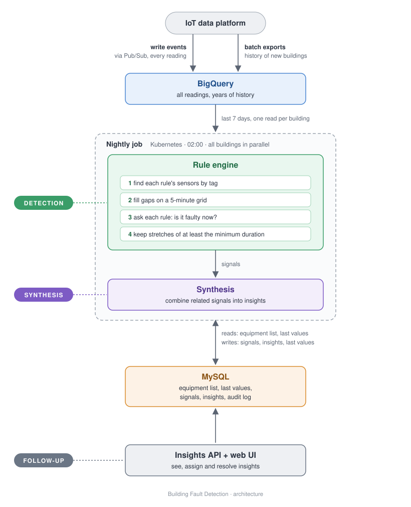

# Building Fault Detection – Design Document

*Author: Betül Dolay · November 2026*

---

## 1. Summary

Building Fault Detection finds performance problems in commercial buildings – wasted energy, comfort issues,
equipment at risk – and turns them into a short list of problems that facility managers, service teams and
installers can act on.

The heart of the system is the **rule engine**: the part that decides what counts as a fault. The rest – storing
data, showing insights, assigning work – is kept deliberately simple.

**The design in five lines,** in three parts:

*Detection*

1. Readings arrive through a **Pub/Sub** subscription and are stored in **BigQuery**, as received.
2. **Every night**, the rule engine (Java, on Kubernetes) evaluates each building over the **last 7 days**.
3. Rules are **small Java classes** that only state *what* is wrong. A shared engine does the hard parts: finding
   sensors by tag, filling gaps in irregular data, and checking minimum durations.

*Synthesis*

4. Faults become **signals** (time periods), and related signals become one **insight**, stored in **MySQL**.

*Follow-up*

5. Users see, assign and resolve insights through a **REST API**.

**Key decisions:**

- **A nightly run is enough.** Insights are usually looked at a day later, so for most faults running the rules
  more often adds nothing for users. Re-checking the last 7 days every night also picks up readings that arrive
  late, without any special logic.
- **One engine, many small rules.** 100+ rules from many developers stay short, readable and testable.
- **Safe to re-run.** Running the engine again never creates duplicates, so failures and late data are easy to handle.

**MVP:** the full chain from reading to resolved insight for all air handling units (AHUs) in the portfolio: about
8 rules, plus a history run when a building joins.

---

## 2. Context and goals

| User | Needs from an insight |
|---|---|
| Facility manager | What's wrong, how serious, is someone on it? |
| Service team | Which buildings need attention. |
| Installer | Which equipment, since when, and the data behind it. |

**Goals:** find real problems before they become energy bills, complaints or damage; one real problem = one
insight; every insight shows the data behind it; grow to 100+ rules and many more buildings without redesign.

**Not in scope:** controlling equipment (the system finds problems; people fix them). Machine learning and
rule writing by non-developers can come later (sections 11 and 12).

| Term | Meaning |
|---|---|
| **Rule** | Detects one fault condition on one type of equipment. |
| **Signal** | One period in which a rule's condition held for one piece of equipment. |
| **Insight** | One problem on one piece of equipment, built from one or more signals, that a person works on. |

---

## 3. Assumptions

| ID | Assumption | Consequence |
|----|------------|-------------|
| A1 | Insights are usually looked at a day later; real-time detection is not needed. | The engine runs once a day. |
| A2 | When a building loses its connection, readings are sent later. | Each run re-checks the last 7 days. |
| A3 | All data, including weather, comes from the IoT platform. It uses one fixed tag vocabulary and provides the list of equipment with its tagged sensors. | One source for everything rules need; rules find sensors by tag. |
| A4 | Change-only sensors are silent when nothing changes. | Their last value stays valid while the same equipment still sends other data. |
| A5 | Rules are written by developers, in code, with the same thresholds for all buildings. | Rules are Java classes. |
| A6 | Domain experts define which signals together form an insight, only on the same equipment for now. | Fixed combinations, in code; combinations across equipment come later. |
| A7 | An insight closes after 48 h without the fault, and reopens if it returns within 14 days. | One problem = one insight. |
| A8 | Users only see their own organization's buildings and log in through the existing platform. | Everything is scoped per customer. |
| A9 | The platform runs on GCP: Pub/Sub, BigQuery and Kubernetes, plus MySQL, GitLab CI and Terraform. | No new technology beyond Grafana for dashboards, which runs on the same cluster. |
| A10 | An example portfolio of about 300 buildings, growing. | Work is split per building. |
| A11 | When a building joins, its history should be evaluated too. | A history run at onboarding, in the MVP. |
| A12 | False alarms are a bigger risk to trust than missed faults. | New rules are tested on history and run hidden before users see them. |
| A13 | There is no on-call duty. | The system recovers by itself; alerts are handled in office hours. |
| A14 | A rule checks a condition at one moment, usually for a minimum time (e.g. at least 30 minutes). Some rules also compare with earlier values (e.g. temperature rising for 2 hours). | The rule states its condition and duration; the engine checks the duration and can give a rule earlier states (section 7.1). |

---

## 4. Scale

| | Today | When 10× bigger |
|---|---|---|
| Buildings | ~300 | ~3,000 |
| Equipment (AHUs, boilers, chillers, loops) | ~3,000 | ~30,000 |
| Readings per day | ~9 million | ~90 million |
| Readings the engine loads per building per run (7 days) | ~200,000 | ~200,000 |

*(Assuming ~20 sensors per piece of equipment and one reading every ~10 minutes.)*

This is a moderate volume: one building's week of data fits easily in memory. **The hard part is correctness**
(irregular data, durations, late data) **and keeping 100+ rules maintainable** – that's where the design puts its effort.

---

## 5. Architecture



<details>
<summary>The same diagram as text</summary>

```
                           IoT data platform
                               │       │
               write events    │       │  batch exports
               via Pub/Sub     │       │  history of new buildings
                               ▼       ▼
            ┌─────────────────────────────────────────────┐
            │ BigQuery                                    │
            │ all readings, years of history              │
            └──────────────────────┬──────────────────────┘
                                   │ last 7 days, one read per building
                                   ▼
            ┌─────────────────────────────────────────────┐
            │ Nightly job · Kubernetes · 02:00            │
            │ all buildings in parallel                   │
            │                                             │
            │  ┌───────────────────────────────────────┐  │
DETECTION   │  │ Rule engine                           │  │
            │  │ find sensors by tag                   │  │
            │  │   → fill gaps on a 5-minute grid      │  │
            │  │   → ask each rule: faulty now?        │  │
            │  │   → keep stretches ≥ minimum duration │  │
            │  └───────────────────┬───────────────────┘  │
            │                      │ signals              │
            │  ┌───────────────────▼───────────────────┐  │
SYNTHESIS   │  │ combine related signals → insights    │  │
            │  └───────────────────────────────────────┘  │
            └──────────────────────┬──────────────────────┘
                                   │ reads: equipment list, last values
                                   │ writes: signals, insights, last values
                                   ▼
            ┌─────────────────────────────────────────────┐
            │ MySQL                                       │
            │ equipment list, last values,                │
            │ signals, insights, audit log                │
            └──────────────────────▲──────────────────────┘
                                   │
            ┌──────────────────────┴──────────────────────┐
FOLLOW-UP   │ Insights API + web UI                       │
            │ see, assign and resolve insights            │
            └─────────────────────────────────────────────┘
```

</details>

**Example, from reading to resolved insight:**

1. On Tuesday from 07:05, AHU 17's heating valve and cooling valve are both open while the fan runs. Because they
   work against each other, the supply air temperature keeps swinging from 07:15. Each reading is stored in BigQuery
   as it arrives.
2. On Wednesday at 02:00, the nightly run evaluates the building's last 7 days. *Heating and cooling at once* held
   for 45 minutes (≥ 30): a **signal**. *Supply temperature unstable* held too: a second signal.
3. Both are on the same AHU at overlapping times, so they become **one insight**: *AHU 17's heating and cooling are
   fighting each other*.
4. On Wednesday morning, the service team sees it with a chart of the data and assigns it to an installer.
5. On Thursday at 02:00, the run sees the same fault again in its 7 days and changes nothing: no duplicates.
6. The installer fixes the valve control and resolves the insight.

---

## 6. Data: stored and made available to rules

| | BigQuery | MySQL |
|---|---|---|
| Holds | Every reading, for years | Equipment list with tags, last known value per point, signals, insights, assignments, audit log |
| Changes? | Never, only added | Often (assign, resolve) |
| Good at | Reading large periods of data cheaply | Changing single rows; guaranteeing no duplicates |

- **Readings** arrive through a Pub/Sub subscription (the platform's write events) and are stored as received, one
  row per reading. The only change: `value` (number or boolean) is split into a
  number column and a boolean column by a small transform. A message that can't be stored goes to a dead-letter
  topic instead of blocking the rest. The table is organised per day and per building, so loading one building's
  last week is fast and cheap.
- **Duplicates:** Pub/Sub can deliver a reading twice. That's harmless: a repeated reading doesn't change the
  engine's filled values or its count of changes, so there is no deduplication step.
- **History** for a building that joins is loaded once from the platform's batch exports into the same table, so the
  history run (section 7.4) works on the same data as the nightly run.
- **The equipment list** – which sensors each piece of equipment has, and their tags – comes from the platform and is
  kept in MySQL. This is what lets a rule ask for "the heating valve of this AHU" without knowing sensor IDs.
- **How rules get their data:** for each building, the engine loads the last 7 days of readings in one query.
  Change-only points may not report for months (e.g. a heating pump that's off all summer), so at the end of every
  run the engine saves each point's **last known value** in a small table in MySQL (one row per point), and the next
  run starts from it. This is the only state between runs; it's small, and it can be rebuilt from the history in
  BigQuery. Rules never query a database themselves; they only see the prepared values the engine gives them
  (section 7).

---

## 7. Rules and the engine

This is the core of the design. A **rule** says *what* is wrong. The **engine** does everything else, once, for all rules.

### 7.1 How a rule is expressed

A rule answers one question: **"is something wrong at this moment?"**

```java
public interface Rule {
    String id();                     // "ahu-heating-and-cooling-at-once"
    int version();                   // bumped when the logic changes
    EquipmentType appliesTo();       // AHU, BOILER, CHILLER, LOOP
    List<Input> inputs();            // needed sensors, by tag
    Duration minimumDuration();      // how long the condition must hold
    default Duration lookback() {    // how far back isFaulty looks; most rules: not at all
        return Duration.ZERO;
    }
    boolean isFaulty(EquipmentState state);  // the condition at one moment
}
```

An **equipment state** is what one piece of equipment looks like at one moment: the values of the rule's inputs, by
tag, with gaps already filled. *(The component in `rule-engine/` builds the core of this interface: `id`, `isFaulty`
and `minimumDuration`; the other methods are needed once rules run across the whole portfolio.)*

An example rule:

```java
public class HeatingAndCoolingAtOnceRule implements Rule {

    private static final Input HEATING_VALVE = Input.tagged("heatingValveCmd");
    private static final Input COOLING_VALVE = Input.tagged("coolingValveCmd");
    private static final Input FAN           = Input.tagged("fanRunCmd");

    private static final double VALVE_OPEN_PERCENT = 10;
    private static final Duration MINIMUM_DURATION = Duration.ofMinutes(30);

    @Override public String id()                { return "ahu-heating-and-cooling-at-once"; }
    @Override public int version()              { return 1; }
    @Override public EquipmentType appliesTo()  { return EquipmentType.AHU; }
    @Override public List<Input> inputs()       { return List.of(HEATING_VALVE, COOLING_VALVE, FAN); }
    @Override public Duration minimumDuration() { return MINIMUM_DURATION; }

    @Override
    public boolean isFaulty(EquipmentState state) {
        return state.valueByTag(HEATING_VALVE) > VALVE_OPEN_PERCENT
            && state.valueByTag(COOLING_VALVE) > VALVE_OPEN_PERCENT
            && state.isOn(FAN);
    }
}
```

The rule **states** its minimum duration (30 minutes); the **engine checks** it. A rule knows nothing about sensor
IDs, missing data, databases or how periods are found. *(Tag names are illustrative; real rules use the platform's vocabulary.)*

The thresholds (10 % open, 30 minutes) are constants, the same for every building (A5). Per-building thresholds come
later: the rule then receives its thresholds instead of defining them, and the engine stays the same.

**Rules that look back in time** use the same kind of rule. The equipment state can give an earlier state, an average,
or a count of changes, and the rule declares how far back it looks (`lookback()`):

```java
return state.changesInLast(BURNER, Duration.ofHours(1)) > 6;                                    // short cycling
return state.valueByTag(ROOM_TEMP) - state.earlier(Duration.ofHours(2)).valueByTag(ROOM_TEMP) > 3;       // rising fast
```

So moment-checks and over-time checks are one kind of rule, and the engine still does the hard parts for both. If a
rule asks for a value that isn't known, also in the past, the engine marks that moment *unknown* (section 7.3). New
helpers are added to the engine, with tests, never inside a rule.

### 7.2 How a rule is applied across the portfolio

For every piece of equipment of the rule's type, the engine looks up each input **by tag**: first on the equipment
itself, then on the building (for example, one outside air temperature sensor shared by the whole building).

| Equipment | Heating valve | Cooling valve | Fan | Result |
|---|---|---|---|---|
| AHU 17 | found | found | found | rule runs |
| AHU 18 | found | **missing** | found | **not applicable** – recorded, visible on the dashboard |

So one rule written once runs on every AHU in the portfolio. Equipment that can't run a rule is recorded rather than skipped
silently, so missing sensors get noticed and fixed. If **two** sensors have the same tag, the rule is skipped and
reported too: the engine never guesses, because the wrong sensor means a false alarm.

### 7.3 How a rule is executed

**Step 1 – Fill gaps in the data.** Sensors report at different moments, and some only when their value changes. The
engine puts all inputs on a **5-minute grid** (the fastest sensors report every 5 minutes) and gives each its **last
known value**, as long as it can be trusted:

| Sensor type | Last value trusted while… |
|---|---|
| Regular (every 5–15 min) | it is less than 1 hour old |
| Change-only (e.g. fan command) | the same equipment is still sending other data |

Silence from a change-only sensor can mean *no change* or *no connection*; the equipment's other sensors tell the
two apart. A value that can't be trusted is **unknown**. The engine only asks a rule when all its inputs are known,
so **unknown never causes a fault** – no alarms based on guesses.

**Step 2 – Ask the rule** at every step of the grid: "is something wrong now?"

| Time | Heating valve | Cooling valve | Fan | Faulty? |
|---|---|---|---|---|
| 07:00 | 40 % | 0 % | on *(06:00 value)* | no |
| 07:05 – 07:45 | 35–45 % | 55–65 % | on *(06:00 value)* | **yes** |
| 07:50 | 40 % | 0 % | on *(06:00 value)* | no |

The fan reported "on" once, at 06:00. It stays trusted because the valves keep reporting.

Each step has one of three answers: **faulty**, **OK**, or **unknown** (the rule wasn't asked, or it asked for a value
that isn't known). If a rule throws an exception, that's a bug in the rule: it is reported for that rule and
equipment, and all other rules keep running.

**Step 3 – Find periods.** Consecutive "yes" steps form a period. Periods shorter than the rule's minimum duration are
dropped, so a 10-minute blip is not a fault. An unknown step ends a period. Each step counts until the next one, so
here 07:05–07:50 is 45 minutes ≥ 30, and it becomes a **signal**.

### 7.4 When it runs

- **Every night at 02:00**, a Kubernetes job evaluates all buildings in parallel, each over the **last 7 days**.
  At ~300 buildings this should take minutes (an estimate: ~200,000 readings per building). When there are many
  more buildings, the job is split over several pods, each taking a share of the buildings.
- **Why once a day:** insights are looked at a day later (A1), so for most faults running more often produces
  results nobody looks at yet. It's simple, cheap, and leaves the night to retry if something fails.
- **Why 7 days:** readings that arrive late (A2), e.g. after a weekend outage, fall inside the next run's 7 days and
  are evaluated automatically. No special late-data logic. Seven is a starting value: it would be tuned to how late
  readings arrive in practice. If cost ever matters, only the days that received new data could be re-checked.
- **History runs:** when a building joins (A11), the same engine runs over its full history, month by month. When a
  new rule is ready, the same mechanism tests it on history (section 10).
- **Failures:** each building is evaluated on its own. If one fails, it is retried; if it keeps failing, the job
  reports it and the team is alerted. Other buildings are never affected, and the next night covers the same days again.
- **It's a setting, not the architecture.** Continuous analysis here means that every building is
  evaluated every day. If some faults ever need faster detection, those rules can be marked as
  **urgent** and run every hour over the last few hours, next to the nightly run. The rules themselves don't change.

### 7.5 Safe to re-run

Each night re-checks days that were already checked. That must never create duplicates:

- A signal is identified by **rule + equipment + start time**, and MySQL enforces this with a unique key.
- The key alone isn't enough: a fault from 09:00 to 15:00 may be seen by the next run as 12:00–15:00, because that
  run's 7 days start at 12:00. So a period that **overlaps or touches** a stored signal of the same rule and
  equipment is **merged** into it: the stored signal is updated, and the earliest start and the latest end win.
- A fault that is still going on at 02:00 is stored as *ongoing*; the next night extends it.
- **Signals only grow.** Late data can extend a signal or merge two, but doesn't shrink or remove one. That keeps the
  logic simple and stops insights from disappearing for users.
- Signals store the **rule version**, so it's always clear which logic produced them.

| Run | What the engine finds for AHU 17 | What happens |
|---|---|---|
| Wed 02:00 | heating-and-cooling fault, Tue 07:05–07:50 | new signal |
| Thu 02:00 | the same fault (still within 7 days) | nothing changes |
| Fri 02:00, after late Tuesday readings arrived | the same fault, now 07:00–07:50 | the existing signal is extended |

### 7.6 How a rule is tested

Because a rule is just a question about one moment, its tests need no database and no time logic:

```java
@Test
void heatingAndCoolingWithFanOnIsFaulty() {
    EquipmentState state = state(40.0, 60.0, 1.0);    // heating valve, cooling valve, fan
    assertTrue(rule.isFaulty(state));
}
```

The engine is tested separately, so each rule doesn't have to be. The component in `rule-engine/` tests a stretch of
exactly the minimum duration, stretches that are too short, the rule's own duration, separate faults, a fault still
going on when the data ends, and no data. The full engine adds
tests for gaps, stale values, silent equipment, missing or duplicate sensors, running twice on the same data, and a
rule that crashes.

---

## 8. From signals to insights

An insight names the **problem**, not the symptoms. Domain experts define which signals belong together (A6):

```java
InsightDefinition.named("ahu-heating-and-cooling-fighting")
    .whenAll("ahu-heating-and-cooling-at-once", "ahu-supply-temp-unstable")
    .severity(Severity.HIGH);
```

- Signals combine when they are on the **same equipment** at **overlapping times**.
- Every rule also has its own simple insight, so a signal on its own is never lost (e.g. heating and cooling run at
  once, but the supply temperature is still stable).
- When a combination matches, the user sees only the combined insight, with the signals as evidence.
- Synthesis runs right after a building's signals are updated, in the same nightly job.

| Status before | What happens | Status after |
|---|---|---|
| – *(no insight yet)* | new matching signal | OPEN |
| OPEN | assigned to a user | ASSIGNED |
| OPEN / ASSIGNED | user resolves it, or no fault for 48 h | RESOLVED |
| OPEN / ASSIGNED | user marks it a false alarm | DISMISSED |
| RESOLVED | fault returns within 14 days | OPEN again (same insight) |

A returning fault reopens the **same** insight, so the team sees that an earlier fix didn't work. A fault only
"returns" if a signal starts after the insight was resolved. Older signals that the 7-day window sees again don't
reopen it.

---

## 9. Follow-up

A small REST API in Java (e.g. Micronaut) with a simple web UI: list and filter insights, view one with its signals and a
chart of the data behind it, assign, comment, resolve or dismiss. Users only see their own organization's
buildings, based on their login. Every change is recorded in an audit log.

---

## 10. Operating and maintaining 100+ rules

**A new rule goes through three steps before users see it:**

1. **Test on history:** run it over the last months of data. Does it fire on 2 AHUs or on 900?
2. **Run hidden:** it runs every night, but its results aren't shown yet. The team checks a sample.
3. **Live:** its signals become insights.

**Automatic checks (GitLab CI)** on every merge request: each rule has tests, a unique ID, belongs to an insight,
uses only known tags, and has its version bumped when its logic changes.

**A dashboard per rule** shows where it applies, where it can't run (missing sensors), how often it fires, and how
often users dismiss it as a false alarm – the clearest sign a rule needs work.

**Dashboards:** I'd use **Grafana**, because one tool can show both the job's health (from Cloud Monitoring) and the
rule quality (from MySQL: how often each rule fires, where it can't run, how often it's dismissed). If the team
already uses another tool, the same dashboards fit there.

**Conventions keep 100+ rules findable:** one class per rule, grouped per equipment type, with its tests next to it.
Each rule has an owner in the code.

**Adding rule #101:** write the rule and its tests, open a merge request, test on history, run hidden, go live.
No change to the engine, the database or the infrastructure.

**Changing a rule:** a new version goes through the same three steps as a new rule. Signals from then on carry the
new version; existing insights stay as they are, so history is never silently rewritten.

**Running it without on-call:** readings wait in Pub/Sub if something is down, failed buildings are retried, and
re-running is always safe. Alerts (a failed building, a building sending no data) are handled in office hours.

**Security:** one service account per component with minimal rights (the engine can read readings, not change
them), no passwords or key files (workloads log in to GCP and MySQL with their own identity), no public IP on the
nodes or the database, data in an EU region.

---

## 11. MVP and later

| MVP | Later |
|---|---|
| AHUs, ~8 rules (e.g. heating and cooling at the same time, fan running outside opening hours, supply air temperature unstable, a sensor stuck on the same value), same thresholds everywhere | Boilers, chillers, loops; 100+ rules; per-building thresholds |
| Nightly run over the last 7 days | Urgent rules run more often, only if a fault type needs it |
| History run when a building joins | – |
| Simple insights and a few combinations | More combinations; rules across related equipment (boiler → loop) |
| API and minimal UI | Notifications, ticketing integrations |
| Test on history, hidden runs, CI checks, basic dashboard | Tools for reviewing hidden rules |
| Energy-meter data stored | Estimated energy cost per insight, for priority |
| – | Machine learning, using resolved and dismissed insights |

**Why this MVP:** it is a complete path from raw data to a resolved insight for the largest equipment group. Adding
other equipment later means writing rules – not changing the architecture.

---

## 12. Alternatives and risks

| Chosen | Alternative | Why not now |
|---|---|---|
| Nightly run | Every 15 minutes, or real-time | Insights are looked at a day later; for most faults, more frequent runs add cost and complexity for no user benefit. |
| Rules in Java on a shared engine | Rules in SQL, or as configuration | Gap-filling and duration logic would be repeated in every rule and is hard to test; configuration can be added later on the same engine. |
| Fixed combinations for insights | Machine learning | Harder to explain and trust; fixed combinations produce the feedback data ML would need. |
| BigQuery for readings | A time-series database | Already in the stack and enough for this volume. |

| Risk | Mitigation |
|---|---|
| Inconsistent tags, so rules don't apply | "Not applicable" is visible per rule; fix tags at the source. |
| Noisy rules, so users stop trusting insights | Test on history, run hidden first, track false alarms. |
| A bug in the engine affects all rules | The engine is heavily tested; engine changes are also tested on history. |

---

## 13. Repository contents

- **Infrastructure as code (Terraform), `infrastructure/`:** the GCP setup from this document, one module per part
  (ingestion, storage, database, compute), plus a placeholder for the IoT platform, which isn't ours to manage.
  The nightly job is a Kubernetes manifest deployed by CI. It passes `terraform validate` and has not been deployed.
- **Java component, `rule-engine/`:** detection, the heart of the engine. The `Rule` interface (an id, a condition
  and a minimum duration), an example rule, and the engine that finds the signals. It is deliberately
  small, with tests. Building the states from raw readings, and storing signals, are designed in section 7 but not
  built. I built this part because every rule depends on it. Its README explains the choices.
- **How I worked:** the design and its choices are mine. Pub/Sub, BigQuery and Terraform were new territory for me,
  so I learned them for this project from the official documentation, with an AI assistant to explain concepts together
  with examples. I also used the assistant to discuss different options, and as a tool to help write the code, its
  unit tests and the Terraform. I reviewed everything thoroughly.
